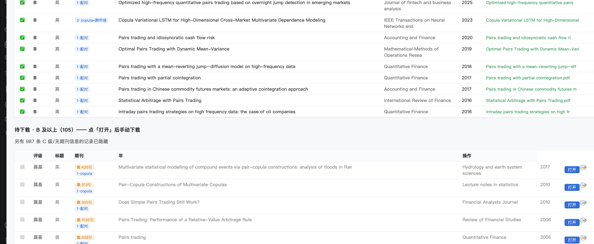

# Paper Download Flow（论文下载流）




按学校期刊分级标准自动筛选、定级、下载学术文献，并生成实时进度看板。

## 它解决什么问题

做文献综述时，你真正想要的是这三步：

1. **按学校标准筛文献**（A+/A/A-/B/C，剔除预警刊）；
2. **把能下的都下下来**（开放获取自动下，订阅库列清单）；
3. **知道现在下到哪了**（哪些成功、哪些还差）。

这个项目把这三步串成一条命令。

## 核心功能

| 功能 | 说明 |
|---|---|
| **多源检索** | OpenAlex（英文）、CNKI（中文），支持多关键词 |
| **期刊定级** | 校定指南 > ablesci（JCR/中科院分区）> 索引；输出 A+/A/A-/B+/B/C |
| **主题相关性** | 标题级关键词命中（配对交易 / copula / 跨市场 / Engle-Granger）|
| **自动下载** | 开放获取直链下载；遇到验证码/403 自动跳过 |
| **手动下载守护** | 你在浏览器里点「PDF下载」，守护进程自动改名、校验、入库 |
| **实时看板** | 浏览器打开一个页面，刷新即更新，已下载打勾 |

## 快速开始

### 1. 环境与依赖

| 依赖 | 用途 | 是否必需 | 安装 |
|---|---|---|---|
| **Python 3.10+** | 运行全部脚本 | 必需 | `brew install python@3.12` |
| **tkinter** | 关键词输入弹窗 | 用 `run.py` 时必需 | `brew install python-tk@3.12` |
| **poppler**（`pdfinfo`）| 校验 PDF 结构 | 必需 | `brew install poppler` |
| **Chrome** | CNKI / 订阅库 / 看板下载 | 抓中文时必需 | 已安装即可 |

> `python-tk@3.12` 里的版本号要对应你的 Python 版本（`python3 --version` 查看）。

**检查是否齐全**

```bash
python3 --version
python3 -c "import tkinter; print('tkinter OK')"
which pdfinfo
which google-chrome || ls -d "/Applications/Google Chrome.app"
```

**一次性安装**

```bash
brew install poppler python-tk@3.12
```

常见报错：

| 报错 | 原因 | 解决 |
|---|---|---|
| `No module named '_tkinter'` | Python 没编 tkinter | `brew install python-tk@<版本>`，或换解释器 |
| `pdfinfo: command not found` | 没装 poppler | `brew install poppler` |

### Windows 用户

| 依赖 | 安装方式 |
|---|---|
| **Python 3.10+** | [python.org](https://www.python.org/downloads/) 安装包，**自带 tkinter**；安装时勾选 “Add Python to PATH” |
| **poppler** | 下载 [poppler-windows](https://github.com/oschwartz10612/poppler-windows/releases)，解压后把 `Library\bin` 加入系统 PATH |
| **Chrome** | 官网下载即可 |

检查（PowerShell）：

```powershell
python --version
python -c "import tkinter; print('tkinter OK')"
pdfinfo -v
```

> Windows 下 `~` 会解析成 `C:\Users\<你>`，脚本用的 `os.path.expanduser('~/Downloads')` 跨平台可用。

> **平台差异**：检索、下载、定级、看板、下载守护全部跨平台；只有“自动点击订阅库”（`cliclick` / `osascript`）是 macOS 专属。Windows 用户遇到订阅库文章时，直接在浏览器点「PDF下载」，其余流程照常。

### 2. 配置路径

打开各脚本顶部的 `D = ...`，把输出目录改成你的（无论你下载到哪里他都会放到这里）：

```python
D = '/path/to/your/论文'        # PDF 与 metadata.json 存放处
```

### 3. 期刊评级可自定义 ⭐

`data/zuel-guide.json` 是**中南财经政法大学**的期刊分级标准（1605 条）。你可以：

**方案 A：改成自己学校的**

直接编辑 JSON，每条长这样：

```json
{
  "section": "中文 A+级期刊",
  "title": "中国社会科学",
  "cn": "11-1211/C",
  "level": "A+",
  "lang": "zh"
}
```

| 字段 | 说明 |
|---|---|
| `title` | 期刊名 |
| `cn` | ISSN 或 CN 号（中文刊）|
| `level` | A+ / A / A- / B / C |
| `lang` | zh（中文）/ en（英文）|

**方案 B：试试你自己的分级**

比如只想要“JCR Q1 = A，其余 = C”，把 `level` 全改掉就行。

**方案 C：不用它**

删掉 `data/zuel-guide.json`，程序会自动回退到 ablesci 的分区数据：

- 中科院/新锐 1 区 → A
- JCR Q1 → B+
- 2 区 → B
- 其他 → C

### 4. 启动（两种方式）

**方式一：图形界面（推荐）**

```bash
python3 run.py
```

会弹出一个窗口：

- 中文关键词、英文关键词分开填；
- **各最多 5 个**（逗号或换行分隔，实时显示 n/5）；
- 点「开始检索」→ 自动跑检索、下载、定级、看板。

**方式二：命令行**

```bash
sh run_all.sh 500 3
```

参数：目标篇数、每词检索页数。


```bash
cd 论文下载流
sh run_all.sh 500 3
```

参数：`目标篇数`、`每词检索页数`。

输出：

```
论文/
├── *.pdf              # 下载的文献（按标题命名）
├── metadata.json      # 全部记录（标题/DOI/期刊/评级/状态）
├── 文献清单.md         # 可读清单
└── 进度看板.html      # 静态看板
```

## 怎么改检索关键词

检索词在两个脚本开头的常量里：

| 脚本 | 常量 | 语言 |
|---|---|---|
| `scripts/batch_collect.py` | `QUERIES` | 英文 |
| `scripts/cnki_search.py` | `QUERIES` | 中文 |

改完直接重跑：

```bash
python3 scripts/batch_collect.py --target 300 --pages 5
```

临时换一批词（不改代码），写个 txt 每行一个词：

```bash
python3 scripts/batch_collect.py --target 300 --queries-file data/queries2.txt
```

## 四个常驻任务

| 任务 | 命令 | 作用 |
|---|---|---|
| 下载守护 | `python3 scripts/watch_downloads.py` | 盯 ~/Downloads，新 PDF 自动入库 |
| 看板服务 | `python3 scripts/board_server.py 8772` | http://127.0.0.1:8772/ 实时进度 |
| 期刊核验 | `python3 scripts/verify_journals.py` | 去 ablesci 查期刊等级 |
| 自动下载 | `python3 scripts/auto_oa_par.py` | 并发版：有 OA 就下，下不了标记手动 |

## 工作流

```
检索（OpenAlex / CNKI）
    ↓
metadata.json（全部候选）
    ↓
定级（指南 + ablesci）
    ↓
┌───────────────┬────────────────────┐
│  auto_oa_par.py │  你点「打开」手动下载  │
│  能下直接入库   │  watch_downloads 接管 │
└───────────────┴────────────────────┘
    ↓
论文/ 目录 + 进度看板
```

## 目录结构

```
论文下载流/
├── scripts/
│   ├── batch_collect.py     # 英文检索 + OA 下载
│   ├── cnki_search.py       # 中文检索（CNKI）
│   ├── verify_journals.py   # ablesci 期刊核验
│   ├── apply_levels.py      # 定级规则
│   ├── auto_oa.py           # 自动下载 OA（串行版）
│   ├── auto_oa_par.py       # 自动下载 OA（并发版，推荐）
│   ├── watch_downloads.py   # 下载守护
│   ├── board.py             # 看板生成
│   ├── board_server.py      # 看板服务
│   ├── stats.py             # 统计汇总
│   ├── board_classify.py    # 分类清单（命中 3/2/1）
│   ├── foundational.py      # 奠基论文采集（引文网络）
│   ├── cleanup.py           # 清理无评级记录
│   └── lib/                 # 公共模块（命名/错误码/JS 表达式）
├── data/
│   ├── zuel-guide.json      # 校定期刊分级（需自行准备）
│   └── journal-verification.json  # ablesci 核验缓存
└── run_all.sh               # 一条命令
```

## 订阅库怎么办

**自动化只能覆盖开放获取（OA）**。Elsevier / Springer / T&F / CNKI 有反爬和登录校验，脚本无法自动通过。

处理方式：

1. `auto_oa_par.py` 把能下的下完；
2. 剩下的标记 `needs_manual`，看板里点「打开」进文章页；
3. 你手动点「PDF下载」；
4. `watch_downloads.py` 自动接管（改名、校验、查重）。

## 数据格式

`metadata.json` 每条记录：

```json
{
  "title": "...",
  "doi": "10.1016/...",
  "venue": "Journal of Financial Markets",
  "year": 2015,
  "issn": "1386-4181",
  "final_level": "A",
  "final_source": "guide",
  "download": "ok",
  "file": "On the determinants of pairs trading profitability.pdf",
  "sha256": "..."
}
```

`download` 状态：`ok` / `not_requested` / `needs_manual` / `dropped` / `fetch_failed:*`。

## 许可

MIT License，见 `LICENSE`。

本工具仅用于学术研究的文献检索与整理。下载的文献内容版权归原作者与出版商所有，使用者应遵守所在机构与出版商的许可协议。